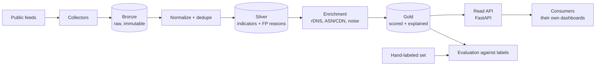

# Threat Intel Pipeline

Turns public threat feeds into a small, ranked set of indicators worth acting on —
with every decision explained.

Public feeds are noisy by design: they report scanning, botnets, shared VPN egress and
legitimate crawlers with the same vocabulary they use for real attacks. This project
normalizes indicators from several feeds, applies **explainable false-positive rules**,
and produces a score that always ships with its reasons.

It is built as a portfolio project in detection / threat-intel engineering. The
interesting part is not the ingestion — it is the evaluation: knowing where the filter
works, where it does not, and being able to prove it.

> **Status: ingestion through API.** The design is written (threat model, source inventory,
> evaluation protocol, decision records). Working today: four collectors feeding one silver
> table, all run live on 2026-11-23 — CISA KEV (1,790 CVEs, 0 rejected), ThreatFox (10,392
> IOCs over 7 days, four indicator types, `ip:port` split, credential in a header), Feodo
> Tracker (public, CC0, per-port entries collapsed to one IP indicator) and URLhaus (103,814
> export rows, 10 unparseable URLs rejected, credential in the URL path). The URLhaus export
> comments out its own header line, so the parser locates it by shape rather than by position.
> On top of silver, two explainable rules run — FP-04 (stale evidence, per-type TTL) and FP-05
> (single-source corroboration) — and a scorer turns their findings into integer points under
> a versioned policy, with structural caps and the reason codes that produced every point. The
> rules report and the scoring summary are reproducible from
> `(snapshot, as_of, config_hash)` and carry ids and counts, never indicator values. The
> snapshot holds 115,476 indicators; 122 URLs are corroborated across ThreatFox and URLhaus,
> which is the cross-source merge the rules depend on. A read-only JSON API serves the scored
> table — filtered pages, per-indicator detail, run aggregates, and the run clock plus both
> config hashes in every data response. It is loopback by default and publishes a new run by
> restarting, so a response can never mix two runs. Evaluation against hand labels is the next
> milestone, so the metrics below stay empty on purpose.

## Architecture



## Design principles

1. **Mark, never discard.** False-positive rules annotate; they do not delete evidence.
2. **Explain or do not score.** Every score carries the codes that produced it.
3. **Evaluate against hand labels, not against the rules.** A filter validated only by
   the signal it was built from proves nothing.
4. **Public feeds are untrusted input.** Data, never instructions.
5. **No feed data in the repository.** Code and schema are public; each operator brings
   their own key.

## False-positive rules

Two rules run today over silver. Each returns a status — `fired`, `not_fired`,
`not_applicable` or `insufficient_data` — and, only when it fires, a coarse strength:

| Code | Question | Reads |
|---|---|---|
| `FP-04_STALE` | Is the evidence older than its type's TTL? | `first_seen` / `last_seen` |
| `FP-05_SINGLE_SOURCE` | Does only one community feed report it? | independent source names |

Full rationale, TTL table and known limits: [`docs/rules.md`](docs/rules.md). The report is
keyed by indicator id and carries counts and rates only, so it can be published even for
feeds whose terms forbid redistributing indicator values.

## Scoring

`make gold` turns the rule verdicts into a ranked table. The score is **integer points under
a versioned policy — not a probability** — and every point ships as a named reason:

| Layer | Examples |
|---|---|
| Base by source class | `SRC_AUTHORITATIVE` +60, `SRC_COMMUNITY` +45, `SRC_UNCLASSIFIED` +30 |
| Adjustments | `KEV_EXPLOITATION` +10, `CORROBORATED` +15, `STALE_EVIDENCE` -30 |
| Caps (guarantees) | stale ≤ 49, single community source ≤ 69, unclassified ≤ 39 |
| Bands | `high` ≥ 70, `medium` ≥ 40, `low` below that |

Caps are not subtractions: they bound the result regardless of the weights, so a tuning pass
cannot silently let stale evidence or a single feed reach the top band. The policy hash
changes whenever a weight changes. Full table, worked examples and limits:
[`docs/scoring.md`](docs/scoring.md).

## Evaluation

The central artifact. Protocol in [`docs/methodology.md`](docs/methodology.md).

| Metric | Value |
|---|---|
| Precision (test set) | not measured yet |
| Recall (test set) | not measured yet |
| False-positive rate per rule | not measured yet |
| Share of indicators sent to review | not measured yet |

These numbers will be published with the configuration that produced them, including
the cases where the filter fails.

## Documents

| Document | Contents |
|---|---|
| [`docs/threat-model.md`](docs/threat-model.md) | What this project protects, from whom, and what is out of scope |
| [`docs/methodology.md`](docs/methodology.md) | Labeling protocol, metrics, ablation, limitations |
| [`docs/rules.md`](docs/rules.md) | FP-04/FP-05 contract, TTLs and known limits |
| [`docs/scoring.md`](docs/scoring.md) | Weights, caps, bands and worked examples |
| [`docs/api.md`](docs/api.md) | Read API contract, cursor semantics, errors and security posture |
| [`docs/sources.md`](docs/sources.md) | Feeds used, terms, limits, collection cadence |
| [`docs/decisions/`](docs/decisions/) | Short decision records with rationale |

## Stack

Python, DuckDB + Parquet for the analytical store, FastAPI/uvicorn for the read API,
pytest for tests. No server to operate; the whole pipeline runs from a checkout.

Deliberate choice: no streaming infrastructure. Volume is measured in tens of
thousands of indicators per day, which a single-process batch job handles comfortably.
Kafka/Spark here would be engineering theater.

## Repository layout

```text
.
├── docs/               # threat model, methodology, sources, decisions
├── src/
│   └── threatintel/
│       ├── collectors/ # one module per source
│       ├── normalize/  # common indicator schema
│       ├── fp_rules/   # FP-04/FP-05, engine, explainable report
│       ├── enrich/
│       ├── scoring/    # policy, scorer, gold table
│       ├── api/        # read-only FastAPI over gold
│       └── dashboard/  # placeholder; frontend is out of repo scope (0002)
├── eval/
│   ├── labeled_sample/ # hand-labeled items (no restricted feed data)
│   └── run_eval.py
├── snapshots/          # generated exports (not versioned)
└── tests/
```

## Getting started

```bash
python -m venv .venv && source .venv/bin/activate
pip install -e ".[dev]"
cp .env.example .env   # add your own feed credentials
```

```bash
make collect-kev        # CISA KEV -> data/bronze/cisa_kev/collection_date=YYYY-MM-DD/
make collect-feodo      # Feodo C2 blocklist -> data/bronze/feodo/... (no credential)
make collect-threatfox  # ThreatFox 7-day batch -> data/bronze/threatfox/... (needs ABUSECH_AUTH_KEY)
make collect-urlhaus    # URLhaus recent export -> data/bronze/urlhaus/... (needs key)
make silver             # bronze -> data/silver/indicators.parquet, upsert by indicator id
make rules              # FP-04/FP-05 report over silver (pass --as-of for reproducibility)
make gold AS_OF=2026-11-23T12:00:00Z   # score into data/gold/indicators.parquet
make api                # serve gold read-only on 127.0.0.1:8000 (restart after make gold)
make ingest             # all four collectors + silver
make test
```

CISA KEV and Feodo Tracker need no credential. ThreatFox and URLhaus do: create a free key
at <https://auth.abuse.ch/>, `cp .env.example .env` and set `ABUSECH_AUTH_KEY` (the Makefile
loads `.env` when present; the file is gitignored). Every collector that talks to a feed
records the last successful fetch per source and refuses a repeat inside one hour
(`--min-interval`), because abuse.ch throttles accounts that exceed fair use. The remaining
sources in [`docs/sources.md`](docs/sources.md) stay unimplemented until their terms row is
verified — and note `docs/decisions/0007`: feed-derived indicator values are never published,
so test fixtures use documentation ranges only. The API serves `/docs`, `/health` and the
`/v1/` endpoints; the dashboard is out of scope, since consumers build their own on top of
the API (`docs/decisions/0002`). Evaluation is not implemented yet.

## Scope

In scope: batch ingestion of a few public feeds, normalization, explainable
false-positive filtering, scoring with reasons, a read-only API, and evaluation on a
hand-labeled set.

Out of scope: dashboards and other frontends (consumers build their own on the API),
real-time streaming, network-traffic detection, paid feeds, commercial product decisions.

## License

MIT — see [LICENSE](LICENSE). The separate tooling this project feeds into has its own
licensing discussion, tracked in the decision records.
