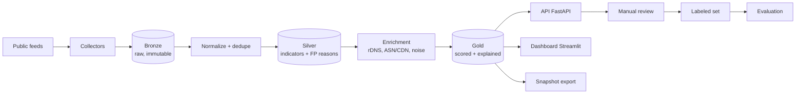

# Threat Intel Pipeline

Turns public threat feeds into a small, ranked set of indicators worth acting on —
with every decision explained.

Public feeds are noisy by design: they report scanning, botnets, shared VPN egress and
legitimate crawlers with the same vocabulary they use for real attacks. This project
normalizes indicators from several feeds, applies **explainable false-positive rules**,
and produces a score that always ships with its reasons.

It is built as a portfolio project in detection / threat-intel engineering. The
interesting part is not the ingestion — it is the evaluation: knowing where the filter
works, where it does not, and being able to prove it.

> **Status: Week 1 in progress.** The design is written (threat model, source inventory,
> evaluation protocol, decision records). Working today: three collectors feeding one silver
> table — CISA KEV (1,790 CVEs on 2026-11-23, 0 rejected), ThreatFox (four indicator types,
> `ip:port` split, credential in a header) and Feodo Tracker (public, CC0, per-port entries
> collapsed to one IP indicator). URLhaus has a bronze-only collector: the credential sits
> in the URL path, so it ships with the redaction design but without a silver mapping until a
> live export confirms the columns. The identity/normalization/merge contract is tested end
> to end, including a cross-source merge on the same IP. No false-positive rules, no scoring,
> no API yet, so the metrics below stay empty on purpose.

## Architecture



## Design principles

1. **Mark, never discard.** False-positive rules annotate; they do not delete evidence.
2. **Explain or do not score.** Every score carries the codes that produced it.
3. **Evaluate against hand labels, not against the rules.** A filter validated only by
   the signal it was built from proves nothing.
4. **Public feeds are untrusted input.** Data, never instructions.
5. **No feed data in the repository.** Code and schema are public; each operator brings
   their own key.

## Evaluation

The central artifact. Protocol in [`docs/methodology.md`](docs/methodology.md).

| Metric | Value |
|---|---|
| Precision (test set) | not measured yet |
| Recall (test set) | not measured yet |
| False-positive rate per rule | not measured yet |
| Share of indicators sent to review | not measured yet |

These numbers will be published with the configuration that produced them, including
the cases where the filter fails.

## Documents

| Document | Contents |
|---|---|
| [`docs/threat-model.md`](docs/threat-model.md) | What this project protects, from whom, and what is out of scope |
| [`docs/methodology.md`](docs/methodology.md) | Labeling protocol, metrics, ablation, limitations |
| [`docs/sources.md`](docs/sources.md) | Feeds used, terms, limits, collection cadence |
| [`docs/decisions/`](docs/decisions/) | Short decision records with rationale |

## Stack

Python, DuckDB + Parquet for the analytical store, FastAPI for the read API,
Streamlit for the dashboard, pytest for tests. No server to operate; the whole
pipeline runs from a checkout.

Deliberate choice: no streaming infrastructure. Volume is measured in tens of
thousands of indicators per day, which a single-process batch job handles comfortably.
Kafka/Spark here would be engineering theater.

## Repository layout

```text
.
├── docs/               # threat model, methodology, sources, decisions
├── src/
│   └── threatintel/
│       ├── collectors/ # one module per source
│       ├── normalize/  # common indicator schema
│       ├── fp_rules/   # one rule per file, with a reason code
│       ├── enrich/
│       ├── scoring/
│       ├── api/
│       └── dashboard/
├── eval/
│   ├── labeled_sample/ # hand-labeled items (no restricted feed data)
│   └── run_eval.py
├── snapshots/          # generated exports (not versioned)
└── tests/
```

## Getting started

```bash
python -m venv .venv && source .venv/bin/activate
pip install -e ".[dev]"
cp .env.example .env   # add your own feed credentials
```

```bash
make collect-kev        # CISA KEV -> data/bronze/cisa_kev/collection_date=YYYY-MM-DD/
make collect-feodo      # Feodo C2 blocklist -> data/bronze/feodo/... (no credential)
make collect-threatfox  # ThreatFox 7-day batch -> data/bronze/threatfox/... (needs ABUSECH_AUTH_KEY)
make collect-urlhaus    # URLhaus recent export -> data/bronze/urlhaus/... (bronze only, needs key)
make silver             # bronze -> data/silver/indicators.parquet, upsert by indicator id
make ingest             # collect-kev + collect-feodo + collect-threatfox + silver
make test
```

CISA KEV and Feodo Tracker need no credential. ThreatFox and URLhaus do: create a free key
at <https://auth.abuse.ch/>, `cp .env.example .env` and set `ABUSECH_AUTH_KEY` (the Makefile
loads `.env` when present; the file is gitignored). Every collector that talks to a feed
records the last successful fetch per source and refuses a repeat inside one hour
(`--min-interval`), because abuse.ch throttles accounts that exceed fair use. The remaining
sources in [`docs/sources.md`](docs/sources.md) stay unimplemented until their terms row is
verified — and note `docs/decisions/0007`: feed-derived indicator values are never published,
so test fixtures use documentation ranges only. API, dashboard and scoring are not
implemented yet.

## Scope

In scope: batch ingestion of a few public feeds, normalization, explainable
false-positive filtering, scoring with reasons, evaluation on a hand-labeled set,
read API, dashboard, review queue.

Out of scope for now: real-time streaming, network-traffic detection, paid feeds,
commercial product decisions.

## License

MIT — see [LICENSE](LICENSE). The separate tooling this project feeds into has its own
licensing discussion, tracked in the decision records.
